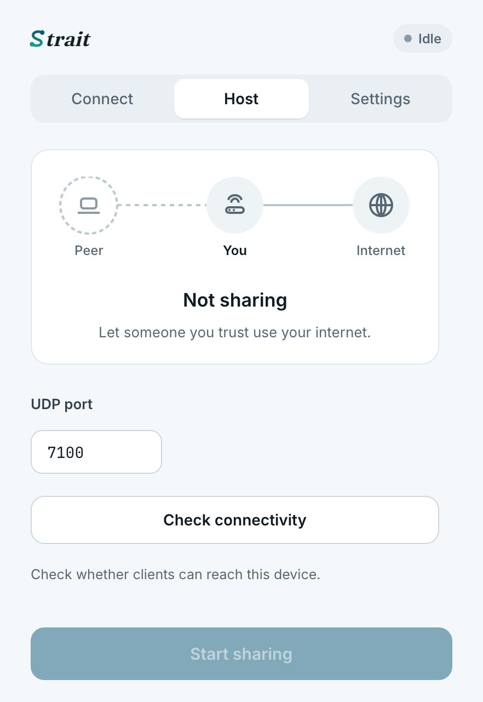
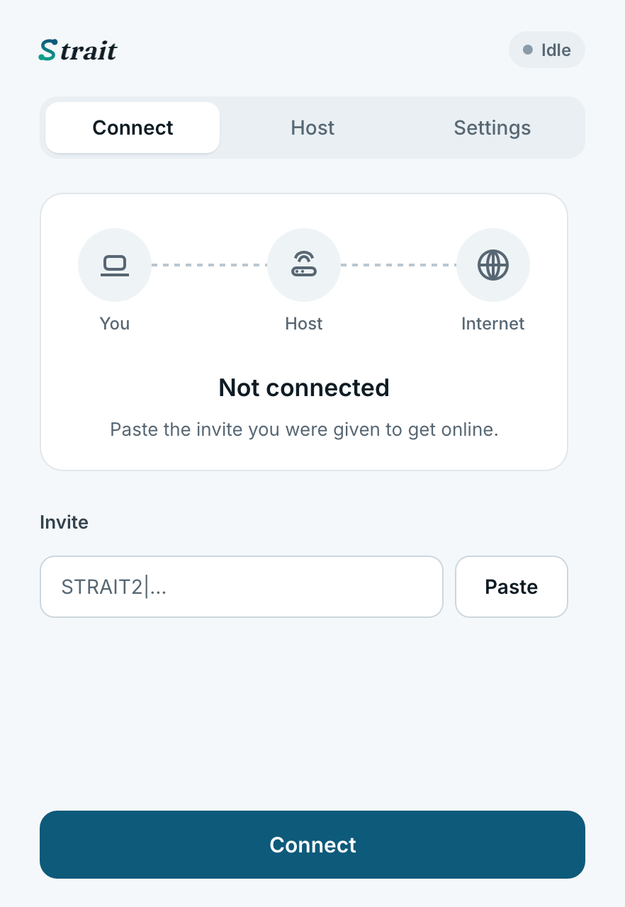
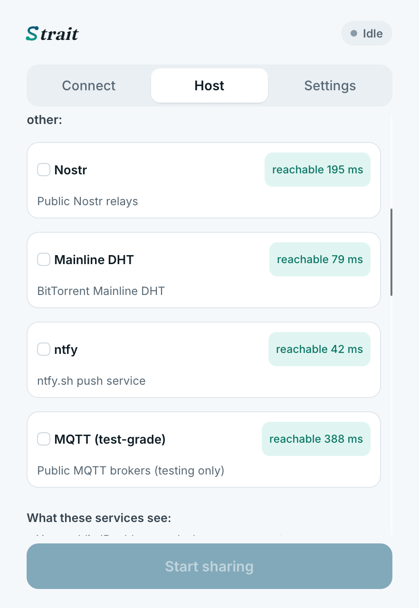

# Strait

<p align="left">
  <a href="https://github.com/TheGreatDaniad/strait/actions/workflows/ci.yml"></a>
  <a href="https://github.com/TheGreatDaniad/strait/releases/latest"></a>
  <a href="LICENSE"></a>
  
  
  
  <a href="nat-tunnel/docs/proverif"></a>
  <a href="https://github.com/TheGreatDaniad/strait/releases"></a>
</p>

<picture>
  <source media="(prefers-color-scheme: dark)" srcset="nat-tunnel/assets/logo/strait-logo-dark.png">
  
</picture>

<br><br><br>

**Use another person's home internet connection, directly, from your own device.**

<br clear="left">

<p align="center">
  
  
  
</p>

## What is Strait?

Strait is software that two people run on their home computers or phones. One of them (the **host**) shares their internet
connection, and the other (the **client**) uses it, through a tunnel between the two devices. The server end of the tunnel is
simply a home device.

That is the problem it solves: getting online through someone you trust, with their connection and their IP address, without
renting a server and without setting one up.

## Easy to use

- One click to run, no configuration. The host starts sharing and gets an invite code; the client pastes it and connects.
- The app checks your network for you and tells you plainly what will and will not work.

## Flexible tunnels

The two peers can choose how they connect. Besides the built-in encrypted UDP tunnel, Strait supports other transports,
for networks that block or inspect traffic:

- Shadowsocks-2022
- Obfuscated UDP in the style of AmneziaWG (our own envelope, not compatible with WireGuard or AmneziaWG clients)
- WebSocket over TLS (TCP). When the host has no reachable TCP port, both sides open the connection to each other through their routers, the same way the UDP tunnel is hole-punched
- Xray (VLESS + REALITY)

## Security

- Every packet is encrypted end to end with ChaCha20-Poly1305. The transports above only change how the packets look.
- A guest joins through a Noise `NKpsk0` handshake. Every invite names the host's own key, so holding an invite is not
  enough to pose as the host, and every session uses fresh keys that are replaced every two minutes.
- A host can give each person a **personal invite**, see who is connected, and remove one person without stopping the others.
  A removal stays in force after the app restarts, a personal invite works on one device at a time, and **Change every
  invite** cancels all old invites at once.
- A guest only reaches the internet through the host: not the host itself, its home network, its router or other guests.
- The services that introduce the two devices only see sealed records; the host signs its own, and the names under which
  records are stored change every day.

- Sharing runs without administrator rights on macOS and Linux. A guest's full tunnel asks for the password, and only the
  tunnel itself runs as root, not the window.

Every security measure, the attack surface and how each part of it is covered are in
**[docs/SECURITY_MEASURES.md](docs/SECURITY_MEASURES.md)**. The protocol is described in
[nat-tunnel/docs/HANDSHAKE.md](nat-tunnel/docs/HANDSHAKE.md), and a [ProVerif model](nat-tunnel/docs/proverif) of the handshake
proves its main properties against an attacker who holds the invite. It has not been audited by an outside party; see
[SECURITY.md](SECURITY.md) to report a problem.

## What each side can do

### I host for my friend. What can my friend do?

**Can my friend use my internet connection?**
Yes, that is the point. Everything they do online leaves from your connection with your IP address, so websites and your provider see it as yours. Share only with people you trust. You can cap how much bandwidth guests may use in the app.

**Can my friend open my computer, its files or the apps running on it?**
No. The host refuses every packet a guest sends to the host's own addresses: its tunnel address (10.7.0.1), its local network address and its public address. The only exception is ping to 10.7.0.1, so the guest can check the tunnel works. The rule is the same in the kernel and the userspace exit, on Linux, macOS and Windows.

**Can my friend reach my printer, my NAS, my cameras or my router's settings page?**
No. Private ranges (10/8, 172.16/12, 192.168/16), link-local addresses, multicast and every IPv6 destination are refused. Your router's public address is refused too, so your friend cannot reach its admin page or your port forwards from the outside. You can open the local network on purpose with `--allow-lan`; the app never does it for you.

**Can my friend see or reach my other guests?**
No. Each guest gets its own address, packets between guest addresses are refused at the host, and each session has its own keys. Even with the same shared invite, one guest cannot read another's traffic.

**Can my friend see my own traffic?**
No. Only the guest's own packets travel through the tunnel. Your browsing does not go anywhere near it.

**Can my friend send spam from my connection?**
Not to mail servers directly: outgoing TCP port 25 is blocked, the port spam goes out on. Ordinary email through a mail provider (port 587) works. If you host on a cloud server, its internal metadata addresses are blocked as well.

**Can my friend give my invite to someone else?**
A shared invite works for anyone who has it, up to the number of guests you allow. That is why personal invites exist: one per person, each with its own id. A personal invite works on one device at a time: a copy is refused as "full" while its owner is connected. A copy can still be used while the owner is offline, and you see it under that person's name.

**Can I throw my friend out for good?**
Yes. **Remove** disconnects them, withdraws their personal invite, and switches on "personal invites only" so they cannot come back with the shared invite. The removal survives restarts. **Change every invite** goes further: it starts a new sharing session with a new invite key, so every old invite, shared or personal, stops working. A removed person then cannot even read where you can be found.

**Can my friend pretend to be me to my other guests?**
No. Every invite names your host key, and only your device holds the private half. The handshake, the signed meeting notes and the WebSocket TLS all check it, so a guest refuses anyone else.

**Can my friend overload my computer?**
There are limits: each guest may keep 64 TCP connections open through you and all guests together 512, a network may start 20 new handshakes every 10 seconds, and one network cannot take more than three quarters of your guest slots. A determined friend can still use the bandwidth you allow.

**Can my friend break into my computer through Strait?**
Only through a bug in Strait's own code, which is written in Rust and checks every packet before it acts on it. On macOS and Linux sharing runs as your ordinary user, so even a bug would not give administrator rights. On Windows the app runs as administrator. Strait has not been audited by an outside party.

**Can my friend find out my IP address?**
Yes. The two devices connect directly, so each sees the other's public address.

### My friend hosts for me. What can the host do?

**Can the host see what I do online?**
Partly, the same way any VPN provider can. The host can see which addresses you connect to, when, and how much, and the names you look up when your DNS is not encrypted. The content of encrypted connections (HTTPS, messaging apps, other VPNs) stays unreadable to the host. Use the host the way you would use a VPN you trust.

**Can the host change what I download?**
Only unencrypted traffic, such as plain `http://` pages. Anything over HTTPS is protected by the website's certificate, which the host cannot fake.

**Can the host get into my computer?**
No. Your device accepts from the tunnel only packets addressed to its own tunnel address that answer something it sent. A new TCP connection from the host is dropped, and UDP is accepted only on ports your device used through the tunnel in the last 3 minutes. Services on your computer (file sharing, SSH, a development server) are not reachable through the tunnel. The host can only ping your tunnel address.

**Can the host reach my home network?**
No. Packets for any address other than your tunnel address are dropped, so even a computer that forwards packets (Docker turns this on) cannot be used as a door into your LAN. Your own local network (10/8, 172.16/12, 192.168/16) stays outside the tunnel: printers and NAS keep working directly.

**Can someone pretend to be my friend's host?**
No. The invite names the host's key, and your device checks it in the handshake, in the meeting notes and in the WebSocket TLS. Someone who has the same invite, or who controls a meeting service, still cannot answer for the host. A forged "host is full" or "refused" answer is impossible too: those answers come inside the encrypted handshake.

**Can other guests of the same host see my traffic or my computer?**
No. Each guest has its own session keys, and the host refuses traffic between guests.

**Can the host make my computer attack someone?**
Only in a narrow way. A host behind a strict router (a symmetric NAT) needs guests to try many ports of its address to get through. A malicious host could name someone else's address in its signed note. That scan is limited to ports 1024 and up, at most 2 addresses for 3 minutes, and 3 times an hour per address, so services on the low ports, such as web (80, 443), mail and SSH, are never touched.

**Can the host learn who I am?**
The host learns your public IP address (the devices connect directly), when you connect, and, with a personal invite, which invite you used. Nothing else about you is sent.

**What runs with administrator rights on my computer?**
To send all your traffic through the tunnel, Strait has to change routes, which needs your password once per connection. Only the small tunnel process runs as root: it is a copy root installed and checked against the program you opened, it receives the invite through a private file (never the command line, where other users could read it), and it writes its log only into a folder root created. The window itself stays an ordinary program on macOS and Linux.

**What happens if the tunnel drops?**
Your normal connection is used again. Strait has no kill switch yet, so in that moment your traffic leaves from your own address. While connected, IPv6 is switched off on every network adapter (Windows) or refused by routes (macOS, Linux), because the tunnel carries IPv4 only.

### What can everyone else do?

**Can my internet provider or someone on the Wi-Fi read the tunnel?**
No. They see encrypted packets between two addresses, how many and when. With one of the other transports the packets also look like Shadowsocks, random UDP, an HTTPS connection or an Xray REALITY connection. They can block the connection; they cannot read it, change it unnoticed, or join it.

**Can someone who scans the internet find a Strait host?**
They can see that a UDP port answers nothing: a host ignores every packet without a valid invite tag. A WebSocket host shows a self-signed certificate to anyone who connects; where that matters, Xray REALITY or a real certificate (`tls=ca`) hides it.

**Can the meeting services (Nostr relays, the DHT, ntfy, MQTT) see my traffic or my invite?**
No. They only carry the sealed note with each device's address, and only until the tunnel is up. They do see the IP addresses that publish and read, and when. The names notes are stored under change every day, so a service cannot easily link one day's meetings to the next. Trackers, which cannot seal anything, are not offered in the app.

**Can a meeting service send me to a fake host?**
No. A guest accepts only host notes signed with the key in its invite, and refuses a note older than 2 minutes. An unsigned address is never scanned.

**Can someone who stole an invite read my sessions?**
No. Every session has its own keys from both sides' one-time keys, so a stolen invite (or even a stolen host key) does not open recorded or current sessions of other people. With a shared invite they can join as a new guest until the host switches to personal invites only or changes every invite.

**Can another program on my computer steal the invite?**
Not from the process list: the invite is never on the command line, which every user of the computer can read. It comes from the window, a private file, the environment or standard input. A program running as your own user can read your own files, as it can for any app.

### What is not covered

These are known and stated in the design notes; none of them lets anyone read a session or reach a device's own network.

- **No kill switch.** If Strait stops or the tunnel drops, the guest's traffic uses its normal connection again.
- **The host is an exit.** It sees where its guests' traffic goes and any unencrypted content, as any VPN provider does. Guests should trust the host that much.
- **Hosting shares your IP.** What a guest does online appears to come from the host.
- **A copied personal invite works while its owner is offline.** The host sees it under that person's name and can remove it.
- **A malicious host can aim its guests' port scan** at an address of its choice, within the limits above.
- **A signed host note can be replayed for 2 minutes** by an invite holder.
- **Windows runs the whole app as administrator.** macOS and Linux run only the tunnel with administrator rights.
- **No outside audit.** The design has a formal model and two rounds of review, but no independent security firm has checked it.
- **Not tested by a person at the screen:** the macOS password prompt for the tunnel process, and the Windows window on a real desktop.

More detail, layer by layer: [docs/SECURITY_MEASURES.md](docs/SECURITY_MEASURES.md).

## No server of your own

Two devices behind home routers cannot normally find each other. When a signaling step is needed, Strait uses public services
(Nostr relays, the BitTorrent DHT, ntfy, MQTT brokers), so you do not have to run a signaling server.
The host decides which ones to use, and they only ever see an encrypted blob. They are used just for the first meeting: once the tunnel is connected, your traffic does not pass through them at all, it goes straight between the two devices.

## In the end

Strait connects device A to device B **peer to peer, with no server in the middle**. Traffic goes only between the two devices,
and A reaches the internet with B's IP address. If a direct connection is not possible, Strait says so with the reason instead of
quietly routing through a third party.

---

## Download

Get the latest build from the [Releases page](https://github.com/TheGreatDaniad/strait/releases/latest).

| System | File | Install |
|---|---|---|
| Ubuntu / Debian (Intel/AMD) | `strait_<version>_amd64.deb` | `sudo apt install ./strait_<version>_amd64.deb`, then open **Strait** from the menu |
| Ubuntu / Debian (ARM) | `strait_<version>_arm64.deb` | same, with the arm64 file |
| macOS (Apple silicon and Intel) | `strait-<version>-macos-universal.dmg` | open it, drag **Strait** to Applications, then right-click it and choose **Open** the first time (the app is not notarized) |
| Windows 10/11 (64-bit) | `strait-<version>-windows-x64.zip` | unzip, keep `Strait.exe` and `wintun.dll` together, double-click `Strait.exe` and accept the administrator prompt (choose **More info > Run anyway** if SmartScreen warns; the app is not code-signed) |
| Linux, other | `strait-<version>-linux-<arch>.tar.gz` | run `./nat-tunnel gui` (it asks for the password through `pkexec` when you connect) |

`SHA256SUMS` lists every file's checksum. On macOS and Linux, sharing needs no administrator rights and the app asks for the
password when a guest connects (the full tunnel changes routes). On Windows the app runs as administrator.
If the window cannot open (no usable graphics), Strait retries with OpenGL and then shows the reason instead of closing silently.

**Mobile:** the Android and iOS apps live in [`strait-mobile/`](strait-mobile). There is no Android or iOS build in
Releases yet; build them from source (an iOS packet-tunnel VPN needs a paid Apple Developer team).

## Quick start

```bash
cd nat-tunnel
cargo run --release -- gui     # desktop app; the full tunnel asks for the admin password
```

1. **Host:** open the Host tab, check connectivity, choose how to be found, press **Start sharing**, copy the invite.
2. **Client:** paste the invite on the Connect tab and press **Connect**.

From the command line, the invite comes from the environment or standard input, never from the command line itself (other
users of the computer can read that):

```bash
STRAIT_INVITE='STRAIT2|...' nat-tunnel host --tun 10.7.0.1/16 --userspace
STRAIT_INVITE='STRAIT2|...' sudo -E nat-tunnel guest --tun 10.7.0.2/24
```

## How it compares

| | Strait | Tailscale exit node | WireGuard or Outline on a VPS | frp |
|---|---|---|---|---|
| What you get | another person's internet connection | another device's internet connection | a server's internet connection | access to services behind a NAT (port forwarding) |
| Exit address | the host's home connection | the exit node's connection | a data-center address | none: frp does not share a connection |
| Server to rent or run | none | none, but devices sign in to Tailscale's coordination service (or a self-hosted Headscale) | the VPS | a public `frps` server |
| If a direct path fails | it says so; traffic never takes a detour | traffic goes through Tailscale's DERP relays | always through the server | always through the server |
| What the guest needs | an invite string | to join the tailnet (an account, or a shared node) | an access key or config | an `frpc` config |
| How the traffic looks | UDP, Shadowsocks, obfuscated UDP, WebSocket/TLS or Xray REALITY | WireGuard UDP, or HTTPS to DERP | WireGuard UDP; Outline uses Shadowsocks | TCP, KCP or QUIC, optional TLS |
| Maturity | experimental, not audited | mature | mature | mature |

In short: a VPS is simpler when a data-center address is fine; Tailscale is the easy choice inside a group that already shares
a tailnet and can live with relays; frp publishes services, not a connection. Strait is for using one trusted person's home
connection directly, with nothing in between and nothing to sign up for.

## Principles

- Payload only travels between the two peers. There is no relay or TURN fallback, ever.
- The invite string is the capability: whoever holds it can connect.
- Failure is explicit, with a reason.
- Servers only help peers find each other. They see a sealed address blob, never your traffic or the key.

## What is here

| Path | What it is |
|---|---|
| `nat-tunnel/` | Rust core: CLI (`host`, `guest`, `check-host`, `rv-test`, `recover`), desktop GUI, rendezvous layer, transports, deploy scripts, docs. |
| `strait-mobile/` | React Native app (Android, iOS) over the same Rust library; not in Releases yet. |
| `nat-tunnel/docs/` | Design (`RENDEZVOUS_DESIGN.md`, `TUNNEL_CARRIERS.md`), plans and roadmap, and the visual design handoff. |

## How peers find each other

The host chooses the methods; nothing is on by default, and each one shows what it can see before you pick it: a UDP signal
server (`sig`), Nostr relays, the Mainline DHT, ntfy, and public MQTT. Rooms are derived from the invite key with HKDF
and change every day, only ChaCha20-Poly1305 sealed endpoints are published, and the host signs its own. BitTorrent
trackers (`trk`) still work from the command line, but they announce in cleartext, so the app does not offer them. See `nat-tunnel/docs/RENDEZVOUS_DESIGN.md`.

## Build and test

```bash
cd nat-tunnel
cargo build --release                      # CLI + GUI
cargo test --no-default-features --features cr-ss,cr-ws,cr-awg   # headless suite (some live-network tests are #[ignore])
cargo run --release -- check-host          # what NAT you are behind and who can reach you
```

The Shadowsocks, AmneziaWG-style and WebSocket transports are built in by default (`cr-ss`, `cr-awg`, `cr-ws`). Xray is an opt-in
build feature (`cr-xray`) because it needs the Xray program installed next to Strait.
Mobile: `cd strait-mobile && npm install && npx jest`. Device builds are in `strait-mobile/ios/README_DEVICE_TESTING.md`.
A packet-tunnel VPN on iOS needs a paid Apple Developer team.

## Test results (AWS NAT lab)

**0.6.0 security round** (same lab, rebuilt): every invite, exit and privilege check passes (details in the
[release notes](https://github.com/TheGreatDaniad/strait/releases/tag/v0.6.0) and
[docs/SECURITY_MEASURES.md](docs/SECURITY_MEASURES.md)); direct connections 12 of 12; through Nostr, MQTT and ntfy 17 of 20, the
failures being WebSocket with a symmetric NAT on one side; a Windows guest reaches 275 Mbit/s. The tables below are from the
v0.4.0 run, which measured every NAT pair.

Measured on AWS, not an emulator: 16 "houses" in 3 regions (Linux arm64 and Windows Server 2022), each behind its own NAT and
controlled over SSM. Peers used public rendezvous only (trackers, Nostr, DHT, ntfy, MQTT), with no server of ours and no relay.
Tested build: the code released as v0.4.0.

NAT types in the lab:

| House | NAT | House | NAT |
|---|---|---|---|
| a | port-restricted (Linux masquerade) | e | address-restricted |
| b | AWS NAT Gateway (symmetric) | f | carrier-grade (two NATs, outer random) |
| c | symmetric (`random` masquerade) | g | UDP blocked (only 53/123) |
| d | full cone | h | public, no NAT |

Linux to Linux, UDP over trackers, ✅ = connects and moves data, ❌ = cannot connect (row = host, column = client):

| host \ client | a | b | c | d | e | f | g | h |
|---|---|---|---|---|---|---|---|---|
| a port-restricted | - | ✅ | ✅ | ✅ | ✅ | ✅ | ❌ | ✅ |
| b symmetric | ✅ | - | ❌ | ✅ | ✅ | ❌ | ❌ | ✅ |
| c symmetric | ✅ | ❌ | - | ✅ | ✅ | ❌ | ❌ | ✅ |
| d full cone | ✅ | ✅ | ✅ | - | ✅ | ✅ | ❌ | ✅ |
| e address-restricted | ✅ | ✅ | ✅ | ✅ | - | ✅ | ❌ | ✅ |
| f carrier-grade | ✅ | ❌ | ❌ | ✅ | ✅ | - | ❌ | ✅ |
| h public | ✅ | ✅ | ✅ | ✅ | ✅ | ✅ | ✅ ws only | - |

- Every pair that is possible without a relay passes, and nothing passes that should not. The only failures are both sides
  symmetric (b, c, f among themselves) and the UDP-blocked house g, which can only use `ws`, and only to a host with inbound TCP.
- Windows to Windows and Windows to Linux behave the same way (91 cross-OS pairs, 60 of 60 repeats for non-symmetric pairs).
- A port-restricted client reaching a symmetric host has to scan ports, which takes 5-59 s. The scan is rate-limited in stages
  (400, then 1500, then up to 4000 packets/s) so it cannot exhaust a small home router's NAT table.
- Throughput, same region: 360-447 Mbit/s; cross-region: 29-130 Mbit/s; 0 % UDP loss in every passing run.
- Transports `udp`, `ss`, `ws`, `awg` and `xray` work on Linux and Windows wherever the network allows them.
- Rendezvous join time: trackers, Nostr, ntfy 0.5-3 s; MQTT 1-5 s; DHT 8-14 s.
- Host on a real home connection (a Mac behind a consumer router, userspace exit): all 7 NAT types connected and moved data.

| Client NAT | First ping | Up / down (Mbit/s) |
|---|---|---|
| port-restricted | 1.0 s | 129 / 137 |
| full cone | 10.1 s | 97 / 128 |
| address-restricted | 4.1 s | 41 / 53 |
| public | 21.3 s | 48 / 52 |
| symmetric (gateway) | 3.2 s | 43 / 58 |
| symmetric (random) | 5.3 s | 32 / 37 |
| carrier-grade | 11.3 s | 24 / 37 |

**WebSocket without a reachable port** (version 0.4.1, two Linux peers behind port-restricted NATs in Frankfurt and Virginia,
the host's TCP port closed to outside connections):

| Case | Result |
|---|---|
| WebSocket only, both directions | ✅ 6 of 6, connected in 1.1 to 1.6 s, 0% loss, 47 to 77 Mbit/s |
| Client with all UDP blocked | ✅ 4 of 4, WebSocket picked automatically when every transport is allowed |
| Idle for 150 s, then traffic | ✅ same session, 0% loss |
| Symmetric NAT on either side | ❌ as expected: the router picks a new port per destination |

Not covered yet: Mac and Android as clients, IPv6, real mobile networks, real consumer routers under the port scan, and the
Windows userspace-exit crash seen in 5 of about 380 early jobs (it is contained, its trigger was never reproduced).

## Notes

- Example addresses use documentation ranges (`203.0.113.0/24`) and the example key `0123456789abcdef0123456789abcdef`.
  Generate your own key; never reuse an example.

## Contributing

See [CONTRIBUTING.md](CONTRIBUTING.md). Issues labelled **good first issue** are a good place to start, and security
reports go through [SECURITY.md](SECURITY.md).

## Development

AI-assisted coding was used in developing Strait.

## License

Licensed under the [Apache License 2.0](LICENSE). You may use, modify, fork and redistribute Strait, commercially or not.
Please keep the [NOTICE](NOTICE) file and the license text with any copy or fork: that is how credit is preserved.

## Disclaimer

Strait is experimental software. It is early work, has not been security-audited, and may contain bugs, flaws and security issues. It is provided **as is**, without warranty of any kind, as stated in the [license](LICENSE). **Use it at your own risk.** The authors are not liable for any damage, data loss, or other consequences of using it.

- **Hosting shares your IP.** When you host, the client's traffic reaches the internet from your connection and appears to come from your IP address. Only share with people you trust, and you stay responsible for what is done through it.
- **Follow the rules that apply to you.** Check your local laws and your internet provider's terms before sharing or using a connection.
- **It is not an anonymity tool.** Strait connects two devices directly, so the two peers see each other's IP addresses.
- **Don't rely on it for anything critical** while it is in this state.
